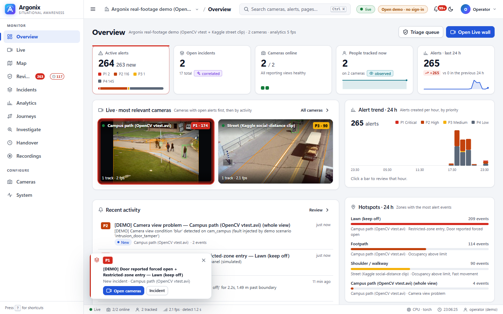
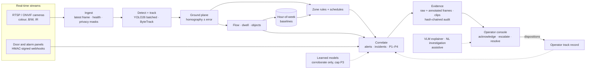
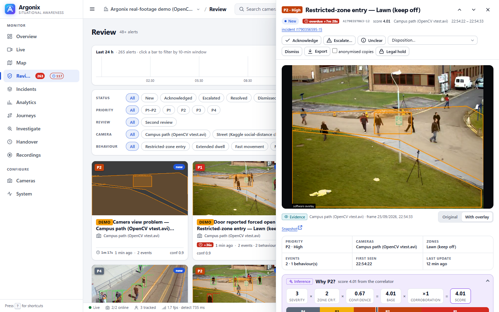
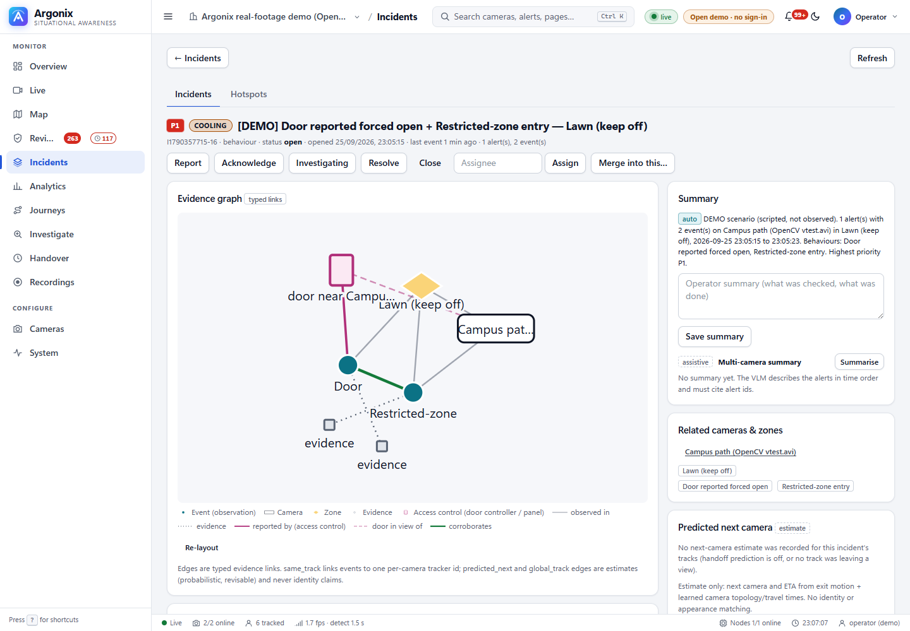
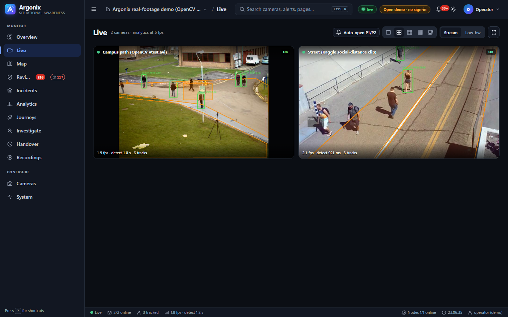
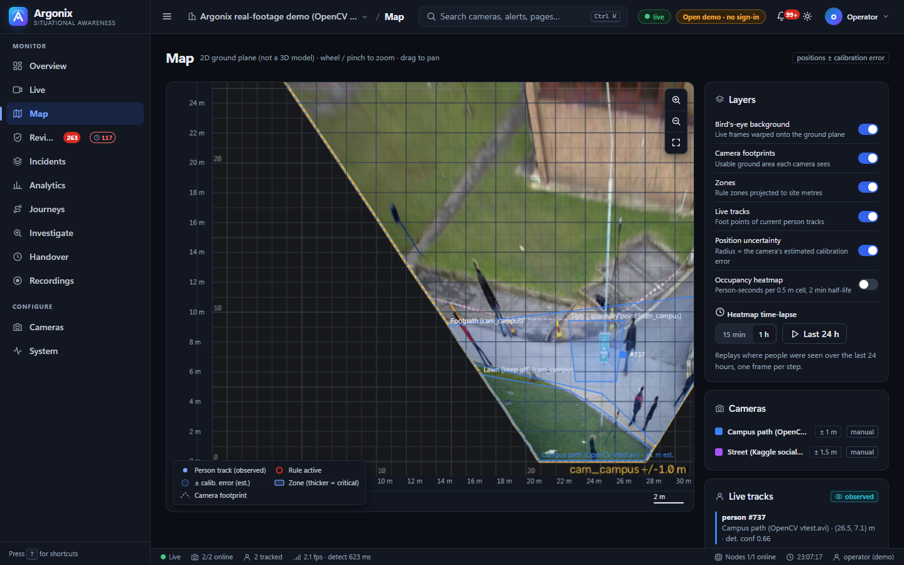

<div align="center">

# Argus

**Intelligent threat detection and situational awareness for the cameras and sensors a site already has.**

Argus watches many live streams at once, finds activity that breaks a rule or departs from what is normal for that place and hour, ranks what matters, and hands an authorised person the evidence and the reasoning. Then the person decides.

[](https://github.com/KumarSrinidhi/Ergomicisc/actions/workflows/ci.yml)




</div>

---

**Contents:** [Problem statement](#the-problem-statement) · [How Argus answers it](#how-argonix-answers-each-part-of-it) · [One incident, end to end](#one-incident-end-to-end) · [Design principles](#design-principles) · [Features](#features) · [Architecture](#architecture) · [Quick start](#quick-start) · [Guided demo](#guided-demo-10-minutes) · [Measured results](#measured-not-claimed) · [Limits](#limits-and-what-is-not-built) · [Repository layout](#repository-layout)

## The problem statement

> **5. Intelligent Threat Detection and Situational Awareness System**
>
> Develop an intelligent situational-awareness system capable of analyzing **multiple real-time data streams** to **detect anomalous activities**, **identify potential security threats**, **prioritize critical alerts**, and **support faster and more informed decision-making by authorized personnel**.

Argus is a working answer to that statement, built as a research demo. It is not a certified security product. It runs on a laptop CPU for two cameras, or on one GPU for many. Every number in this README says where it was measured.

### Why this is hard, and what Argus does about it

Control rooms rarely lack cameras. What they lack is attention:
- one operator can't watch forty tiles;
- motion-triggered alarms bury the one alert that matters under hundreds that don't;
- "the AI flagged it" is not a reason anyone can act on, or defend afterwards.

Argus is built around four answers:

1. **Understand the scene, not just pixels.** People and vehicles are tracked and mapped onto a measured ground plane. Rules then speak in metres, seconds and named zones ("inside *Server room door* for 4 s, 1.2 m past the boundary"), not "motion in region 3".
2. **Know what normal looks like here.** Occupancy, event rates and dwell times are learned per zone and per hour of the week. "Busy" at 9 am on a Monday and "busy" at 2 am on a Sunday are different things.
3. **Fuse and rank.** Events from different cameras, rules and door sensors that describe one situation become one incident with one priority. The priority is a formula the operator can read, not a black box.
4. **Keep people in charge.** Deterministic rules raise alerts. Learned models only corroborate them, and every alert separates *what was seen* from *what was inferred*. Nothing is ever said about who someone is or what they intend.

## How Argus answers each part of it

| The statement asks to… | What Argus does | Where to see it |
|---|---|---|
| **analyse multiple real-time data streams** | Many RTSP/ONVIF cameras (colour, black-and-white, IR) processed concurrently: one worker per camera, one shared batched GPU detector, automatic reconnect. **Door and alarm panels** arrive as a second, independent stream (HMAC-signed webhooks), and **PIR motion sensors** (an ESP32-CAM node) are polled as a third. USB webcams can request a capture mode such as 1280×720 MJPEG. Inference can move to remote GPU nodes. | **Live**, **Cameras**, **System → Compute** |
| **detect anomalous activities** | 13 zone rules (intrusion, loitering, running, wrong way, crowding, counter-flow, density, queues, dispersal, convergence, line crossing, vehicles) with schedules. Hour-of-week baselines for occupancy (point test + CUSUM), event rate and dwell. Unattended objects, camera tampering, a trajectory anomaly score. **"What changed vs normal?"** compares the last hours with previous weeks. | **Review**, **Analytics**, **Investigate** |
| **identify potential security threats** | Restricted-zone entry; forced or held doors **fused with the video of that door**; camera covered, blurred, dark, moved or frozen; vehicles in pedestrian zones. Experimental and off by default: weapon-like objects, possible altercation, person on the ground. | **Incidents** (evidence graph) |
| **prioritise critical alerts** | Events that belong together become one incident. The priority is severity × zone criticality × confidence × corroboration, banded P1–P4, and shown as "Why P2?". Cross-camera and cross-modal agreement raises it. A model acting alone is capped at P3. The rule's **track record with operators** is shown alongside. There are acknowledge SLAs, a flood banner and a push budget. | Alert drawer → **Why P2?** |
| **support faster, better-informed decisions** | Evidence first: raw and annotated frames plus clips. Synchronised multi-camera replay. Next-camera prediction and cross-camera journeys. A bird's-eye map. Natural-language investigation with cited alert ids. An on-request VLM description. Incident reports and shift handover. The recommended cameras open automatically on P1/P2. | **Incidents**, **Map**, **Journeys**, **Handover** |
| **…by authorised personnel** | Accounts with 6 roles (viewer, operator, supervisor, admin, auditor, integration), sessions, API tokens, CSRF and TLS. A hash-chained audit log that also records who watched which camera. Signed evidence bundles, legal hold, retention, privacy masks and face blur on export. | **Users**, **System**, audit API |

## One incident, end to end

What happens when someone forces the server-room door at 02:10 and walks in:

1. **Streams arrive.** `cam1` (server wing) is decoded by its worker thread. At the same moment the door controller posts `door_forced` for door D1 to `/api/sensors/events`. Argus checks the HMAC signature, the clock skew and replay, and maps D1 to `cam1` and zone *Server room door*.
2. **Detection and tracking.** The shared YOLO26 detector (batched across all cameras) finds a person, and ByteTrack gives them track #54. The foot point is projected through the camera's homography to ground coordinates, with a stated error of about 0.3 m.
3. **Rules.** The track is 1.2 m inside *Server room door*, more than the calibration error, for longer than 1 s. The `intrusion` rule fires with an *observation* ("person track #54 inside 'Server room door' for 2.0 s, 1.2 m past boundary") and a *derivation* (rule, thresholds, duration, calibration error). If the rule has an after-hours schedule, it is armed at 02:10.
4. **Correlation.** Within 15 s, the door event and the video event share the site zone `server_door`. They become **one alert** with two modalities, and corroboration raises the score to P1. An operator can read why: severity 3 × criticality 3 × confidence 0.8, × 1.5 for sensor + video agreeing.
5. **Incident.** The alert opens an incident with an evidence graph: door report → zone entry → one P1. If `cam1` had been covered first, the tamper alert would join the same incident, and its later recovery would be noted on it.
6. **Operator.** The P1 toast offers **Open cameras**: `cam1` large, related cameras beside it, and the handoff model's predicted next camera, dashed and labelled as an estimate. The acknowledge SLA clock (60 s for P1) starts. Telegram or ntfy push goes out if configured.
7. **Decision.** The drawer shows the raw frame, the clip, the "Why P1?" breakdown, and the rule's track record here ("operators confirmed 9 of 10 …"). The operator acknowledges and escalates with a reason. Later they resolve the alert with a disposition, which feeds the rule's precision statistics.
8. **Record.** Every step goes into the hash-chained audit log, including who opened the live view. The alert can be exported as a signed evidence bundle, with anonymised copies if needed, and held against retention.

You can run exactly this with **System → Demo scenario → Run**. It is scripted, and every alert it creates is labelled DEMO.

## Design principles

| Principle | What it means in the code |
|---|---|
| **Report what was seen** | Every alert keeps the *observation* separate from the *derivation* (rule, threshold, calibration error) and from any *inference*. The UI labels each with its own badge. |
| **Rules decide; models corroborate** | Deterministic rules and statistical baselines raise alerts. An alert backed only by a learned model (anomaly score, weapon or altercation model, forecast) is capped at **P3** until a rule agrees. The VLM only explains, on request, and is labelled assistive. |
| **Explain the priority** | "Why P2?" shows the factors, the P-bands, any cap or demotion, and how operators judged this rule on this camera before. |
| **Never label people** | No face recognition. No "suspicious person". Cross-camera IDs are opaque numbers for one journey: probabilistic, revisable by operators, and purged after an hour. |
| **Evidence you can defend** | The raw frame is kept next to the annotated one. Export bundles are SHA-256 hash-chained and HMAC-signed. The audit log is hash-chained. Legal holds survive retention. |
| **Say what was measured** | Accuracy claims name the dataset and hardware. Weak results are published, and they are why some features stay off by default. |

## Features

Maturity labels: **Core** is on by default and tested. **Opt-in** means configure it to use it. **Experimental** means off by default, research-grade and capped at P3.

### 1. Multiple real-time data streams

| Feature | Maturity | Notes |
|---|---|---|
| RTSP / ONVIF cameras | Core | WS-Discovery, 7 vendor URL templates (Hikvision, Dahua, Axis, Reolink, Uniview, Tapo, generic ONVIF), a stream test before saving, RTSP over TCP, reconnect with backoff, latest-frame grabbing so a slow camera never builds a backlog |
| Black-and-white / IR cameras | Core | Monochrome detection, CLAHE enhancement (`auto`, `clahe` or `off`) |
| Camera management from the dashboard | Core | Add, edit and remove cameras, zones, masks and counting lines with a polygon editor; atomic config saves; credentials kept out of the config |
| Door and alarm panels | Core | `POST /api/sensors/events`: HMAC-signed, clock-skew and replay protected, doors mapped to cameras and zones, card ids stored only as keyed hashes. `tools/sensor_sim.py` simulates a panel |
| One batched GPU detector for all cameras | Core | YOLO26 + per-camera ByteTrack, fp16, optional TensorRT engines, CPU fallback |
| Remote GPU inference nodes | Opt-in | `tools/infer_server.py` on another machine; the site streams frames to it (**System → Compute**) |
| Smooth live view and main-stream recording | Opt-in | WebRTC/WHEP through MediaMTX; stream-copy recording of the camera's main stream |
| Camera health | Core | Covered, dark, blurred, moved, frozen, down; recovery noted on the alert |

### 2. Detecting anomalous activity

| Feature | Maturity | Notes |
|---|---|---|
| Zone rules | Core | `intrusion`, `loitering`, `running`, `wrong_way`, `crowding`, `line_cross` (per direction), with conservative boundaries (inside by more than the calibration error), persistence and re-arm |
| Flow rules | Opt-in per zone | `counterflow`, `density` (people per m²), `queue_long` (Little's law), `dispersal`, `convergence` |
| Schedules | Core | Per zone or per rule ("after hours", weekends, overnight windows) |
| Vehicles | Opt-in | `vehicle_in_zone` (a car in a pedestrian zone), `vehicle_stopped` (no-stopping zones) |
| Unattended objects | Opt-in | Backpack, handbag or suitcase left static and alone (default 30 s, owner more than 3 m away) |
| Hour-of-week baselines | Core | Occupancy (median/MAD point test + CUSUM for sustained shifts), event rate per zone, dwell per zone |
| Baseline-aware loitering | Opt-in | Alert on stays that are long *for this zone at this hour* (p95 of past stays), not a global constant |
| Trajectory anomaly score | Opt-in, corroboration only | IsolationForest on track features; can raise a score, never a P1/P2 alone |
| **What changed vs normal?** | Core | Investigate → one click compares the last 1–24 h with previous weeks at the same hours: occupancy, event rate, dwell and camera views, ranked by z-score, listing what has too little history |
| Zone congestion forecast | Core | "Next 5 minutes" occupancy per zone, labelled as a prediction, with error against a naive baseline |

### 3. Identifying potential threats

| Feature | Maturity | Notes |
|---|---|---|
| Restricted-zone entry | Core | The primary security rule; ground-plane or pixel zones |
| Forced or held door + video | Core | A door report and the video of that door become one cross-modal incident (sensor + video) |
| Camera tampering | Core | Covering, spray, defocus, moving the camera, freezing the feed; a tamper incident mutes that camera's other alerts so it can't flood the operator |
| Weapon-like objects | Experimental | Fine-tuned YOLO26n; handgun AP50 0.91 on its test split, but poor on CCTV-style views (see results) |
| Possible altercation | Experimental | Pose pair-GRU vs a heuristic, on RWF-2000 |
| Person on the ground (fall) | Experimental | Pose heuristic plus an optional classifier; 0 of 3 on CAVIAR, explained in the app README |

### 4. Prioritising critical alerts

| Feature | Maturity | Notes |
|---|---|---|
| Correlation into alerts | Core | Events on the same site zone or track within 15 s merge; each extra rule, camera or modality raises the score |
| Incidents | Core | The operator-facing situation: lifecycle (open, active, cooling, closed, reopen), merge/split, a typed evidence graph |
| Explainable priority | Core | P1–P4 bands from severity × criticality × confidence × corroboration; "Why P2?" in every alert |
| Learned-only cap | Core | Model-only alerts stay at P3 or below until a deterministic rule agrees |
| Operator track record | Core | Per rule and camera: how many reviewed alerts were confirmed, with a Wilson 95 % interval |
| Feedback demotion | Opt-in | A single, uncorroborated alert from a rule operators keep rejecting drops one band, and says why |
| Acknowledge SLA | Core | Per-priority timers (P1 60 s, P2 5 min), overdue badges, one automatic escalation of an unacknowledged P1/P2 incident |
| Alert-flood handling | Core | A banner and a P1/P2-first compact review during floods; a push budget (P2 is rate-limited, P1 always goes out) |
| Phone push | Opt-in | Telegram and ntfy (or any HTTP endpoint), only for incidents the budget lets through, at or above each channel's minimum priority |

### 5. Faster, better-informed decisions

| Feature | Maturity | Notes |
|---|---|---|
| Operator console | Core | Overview, Live wall, Review, Incidents, Analytics, Journeys, Map, Investigate, Recordings, Handover, Cameras, Users, Settings, Compute, System; light and dark themes; phone layout |
| Alert drawer | Core | Evidence first (raw frame / with overlay, clip), observation vs derivation, "Why P?", legal workflow buttons for your role |
| Auto-open cameras | Opt-in (per browser) | On a P1/P2: the primary camera, related cameras, and predicted next cameras (labelled estimates) |
| Synchronised replay | Core | Every camera of an incident, on one timeline |
| Bird's-eye site map | Core | Tracks and zones on the ground plane with the calibration error shown; heatmap and time-lapse |
| Robust calibration | Core | 4 or more image↔ground point pairs; with 5+ the fit rejects mistyped points and reports a leave-one-out error; pedestrian self-calibration |
| Next-camera prediction | Core (research-grade) | A learned site topology predicts where a person leaving a view will reappear, and when |
| Cross-camera journeys (Re-ID) | Opt-in (research-grade) | OSNet embeddings plus probabilistic, revisable global ids; operators can split or merge |
| Trajectory forecasting | Experimental | GRU vs constant velocity; about tied (published) |
| Natural-language investigation | Core | "Crowding near the server wing yesterday evening": translated into an allow-listed query (never SQL), answered with cited alert ids, editable as chips |
| VLM explainer | Opt-in (GPU) | Qwen2.5-VL describes the evidence on request; labelled "assistive, not evidence"; never triggers or scores alerts |
| Incident report, VLM incident summary, shift handover | Core | A printable HTML report; what is still open at shift end |
| Demo scenarios | Core | A scripted, clearly labelled DEMO sequence for rehearsals |

### 6. Authorised personnel, accountability and privacy

| Feature | Maturity | Notes |
|---|---|---|
| Accounts and roles | Core | viewer, operator, supervisor, admin, auditor, integration; first-run setup code; PBKDF2 passwords; idle and absolute session limits; login throttling |
| Scripts and integrations | Core | HTTP Basic and scoped API tokens |
| Web hardening | Core | CSRF header, CSP and security headers, optional TLS (`tools/make_cert.py`), credentials redacted from logs |
| Tamper-evident audit log | Core | Every decision, export, hold and sweep, hash-chained, with `/api/audit/verify` |
| Footage access log | Core | Who opened which live view and evidence file, in the same chain |
| Evidence bundles | Core | Zip with a SHA-256 manifest chain, an HMAC signature and the audit head; server-side verify |
| Retention and legal hold | Core | Age and disk caps for recordings, evidence and closed alerts; held alerts are never swept |
| Privacy masks | Core | Painted black before detection, recording, snapshots, live view, the VLM and export |
| Face and head blur | Core / opt-in | Anonymised copies in exports; optional blur before images go to the VLM |

## Architecture



**One Python process** (FastAPI + SQLite):
- one worker thread per camera and a shared batched detector;
- a correlator and incident manager;
- a WebSocket that pushes alerts and incidents to a vanilla-JS dashboard, with no build step and no external database.

Heavy parts can move to other machines: GPU inference nodes, the VLM server, and MediaMTX for restreaming. The whole thing restarts from its SQLite files.

| Stage | Main modules (`argonix_app/argonix/`) |
|---|---|
| Ingest and health | `pipeline.py` (Site, CameraWorker), `cameras.py`, `imaging.py`, `health.py`, `privacy.py`, `restream.py` |
| Detection | `detect.py`, `inference.py` (batched GPU), `remote_inference.py`, `infer_server.py` |
| Geometry | `geometry.py` (homography, N-point fit), `autocalib.py`, `birdseye.py` |
| Rules and statistics | `rules.py`, `schedule.py`, `flow.py`, `objects.py`, `baseline.py`, `anomaly.py`, `congestion.py`, `changes.py` |
| Threat analyzers | `threats.py`, `altercation.py`, `fall.py` |
| Correlation and priority | `correlate.py`, `incidents.py`, `track_record.py`, `workflow.py`, `notify.py`, `sensors.py` |
| Multi-camera | `handoff.py`, `reid.py`, `osnet.py`, `global_ids.py`, `forecast.py` |
| Decision support | `investigate.py`, `vlm.py`, `replay.py`, `report.py`, `handover.py`, `narrative.py` |
| Trust | `auth.py`, `security.py`, `store.py` (audit chain), `feedback.py` (evidence bundles), `retention.py` |
| API and UI | `server.py`, `api_*.py`, `static/` (`index.html`, `app.css`, `js/`) |

## Quick start

You need [uv](https://docs.astral.sh/uv/) and Python 3.11–3.13. No GPU is required.

```bash
git clone https://github.com/KumarSrinidhi/Ergomicisc.git
cd Ergomicisc/argonix_app
uv sync --extra cpu                      # NVIDIA GPU: --extra cu126 (driver 527 or newer)
uv run python tools/setup_assets.py      # weights, public clip, demo clips (git doesn't carry them)
uv run python run.py --open-demo
```

Open http://127.0.0.1:8000. The first start renders a small synthetic two-camera scene, so you see tracks and alerts without any footage. `--open-demo` skips sign-in. Without it, the first start prints a one-time setup code for creating the admin account.

### Files git doesn't carry

Model weights and video clips live in the git-ignored `argonix_app/data/`. `tools/setup_assets.py` downloads or renders them. Run it once after cloning, and again whenever you like: it skips what is already there, resumes partial downloads and checks pinned SHA-256 hashes. `--check` lists what is missing without changing anything.

| Group | What you get | Needed for |
|---|---|---|
| `core` (default) | `yolo26n.pt` detector, OpenCV `vtest.avi`, the two synthetic demo clips | `run.py --open-demo`, `configs/real_site.json` (campus camera), the tests |
| `models` | `yolo26s.pt`, `yolo26n-pose.pt` | the GPU configs, fall detection, altercation |
| `street` | the Kaggle street clip (`pedestrian.mp4`) | the second camera in `configs/real_site.json`; needs `KAGGLE_API_TOKEN` (or `KAGGLE_USERNAME` + `KAGGLE_KEY`) |
| `reid` | OSNet-AIN Re-ID weights (MSMT17, non-commercial research terms) and the rendered 3-camera scene | `configs/reid_demo.json` |
| `handoff` | the rendered 3-camera handoff scene | `configs/handoff_demo.json` |

```bash
uv run python tools/setup_assets.py --all              # every group
uv run python tools/setup_assets.py --only models,reid # just these
```

It doesn't fetch the fine-tuned weapon and altercation weights: their training data has an unknown licence, so they aren't redistributed (train them with `tools/train_weapons.py` and `tools/train_altercation.py`). TensorRT engines are GPU-specific (`tools/bench_gpu.py --export`), the VLM server downloads its own weights, and the evaluation datasets come from `tools/datasets.py`.

### Other ways to run it

| Goal | Command (from `argonix_app/`) |
|---|---|
| Real public footage (two cameras) | `uv run python run.py --config configs/real_site.json --data data/run_real --port 8001` |
| Three-camera handoff scene | `uv run python run.py --config configs/handoff_demo.json --data data/run_handoff --port 8002` |
| Cross-camera journeys | `uv run python run.py --config configs/reid_demo.json --data data/run_reid --port 8004` |
| Your own cameras | **Cameras → Add** (RTSP URL, vendor template or ONVIF discovery), or copy `configs/demo_site.json` and set each camera's `source` |
| Pre-demo checklist | `uv run python tools/preflight.py --config configs/real_site.json --port 8001` (PASS/WARN/FAIL for weights, sources, ports, services) |
| Tests | `uv run pytest -q -m "not slow"` (the set CI runs); drop `-m` for the full suite |

On a CUDA host use `uv run --no-sync` for all of these, so uv doesn't swap the CUDA torch build for the CPU one.

## Guided demo (10 minutes)

1. **Overview.** KPIs, the most relevant cameras, the alert trend, hotspots.
2. **System → Demo scenario → Run.** A restricted-zone entry, a forced door and a covered camera arrive within seconds. They are scripted and labelled DEMO.
3. **The P1 toast → Open cameras.** The focus layout opens the primary camera, related cameras and the predicted next camera.
4. **Incidents.** One P1 incident with its evidence graph (door report + zone entry + tamper), instead of three unrelated alerts.
5. **Alert drawer.** Raw frame vs overlay, observation vs derivation, **Why P1?** (factors, cross-modal corroboration, track record), then acknowledge → escalate with a reason.
6. **Map.** The same event on the bird's-eye plan, with the calibration error.
7. **Investigate.** "restricted-zone entries by hour this week", then **What changed vs normal?**
8. **Handover and report.** What is open at shift end; the printable incident report; an exported, verifiable evidence bundle.

The full walkthrough with talking points is [`argonix_app/docs/DEMO_SCRIPT.md`](argonix_app/docs/DEMO_SCRIPT.md).

| Alert drawer | Incident evidence graph |
|---|---|
|  |  |
| **Live** | **Map** |
|  |  |

More screenshots: [`argonix_app/README.md#screenshots`](argonix_app/README.md#screenshots).

## Measured, not claimed

Every result names its data and hardware. The full tables, commands and caveats are in [`argonix_app/README.md`](argonix_app/README.md#measured-not-claimed); raw result files are in [`argonix_app/eval_runs/`](argonix_app/eval_runs/).

| What | Result | Where |
|---|---|---|
| Batched detection (TensorRT YOLO26s) | about 20 cameras at 10 fps | RTX 3050 Laptop GPU (Linux) |
| Same, on a Windows RTX 4050 laptop | 2 cameras at 10 fps strictly, about 4 in practice: host-limited (GPU 20–35 % busy); performance-core pinning gave 1.4–1.8× | RTX 4050 Laptop GPU |
| Detection on CPU | about 200 ms per frame, 2 cameras at 480 px | laptop CPU |
| VLM explanation (Qwen2.5-VL-3B, 4-bit) | about 2 s each | RTX 3050 |
| Tracking (YOLO26s @960, conf 0.1 + ByteTrack, 5 fps) | HOTA 0.37, IDF1 0.44, detection recall 0.45 / precision 0.89 (was 0.28 recall at 480 px, conf 0.3) | MOT17 train, 7 sequences |
| Rules on CAVIAR, imgsz 960 | crowding vs meetings: recall 0.50, precision 0.25; loitering precision 0.06 | CAVIAR, 27 clips, no calibration |
| Re-ID, same person vs different person on one camera | ROC AUC 0.89 (OSNet-AIN) | RTX 4050, OpenCV `vtest.avi` |
| Re-ID across 3 cameras (31 true links) | precision 0.61, recall 0.36 | rendered scene |
| Next-camera prediction | 86 % vs 81 % baseline, not significant | rendered 3-camera video |
| Trajectory forecast | about tied with constant velocity (ADE 0.53 m) | ETH/UCY, leave one scene out |
| Weapon detector (fine-tuned) | handgun AP50 0.91 on its test split, but 8 % recall on CCTV-style views | RTX 4050 |
| Altercation (pose pair-GRU) | ROC AUC 0.68 vs 0.65 for the heuristic | RTX 4050, RWF-2000 test |
| Fall detection | 0 of 3 CAVIAR falls detected; 0 false alarms in 4.6 min of normal footage | laptop CPU |
| Auto-calibration | 0.29 m ground error at 10 m | synthetic scene |

Weak results are published too, and they are why those features stay off by default. Detector recall on small, distant people was the main limit; a lower confidence cut and a 960 px input on the GPU raised it by 61 % (see the MOT17 notes). Model limits are in the [model cards](argonix_app/docs/model-cards/).

## Limits and what is not built

- **Detector recall on small, distant people is the main limit.** MOT17 detection recall is 0.32 at 480 px. On CAVIAR's wide-angle lobby, rule precision is low: loitering 0.06, crowding 0.25. Larger input sizes, better cameras or a GPU-sized model help. The operator track record and optional feedback demotion are how a deployment measures and damps a noisy rule.
- **Research-grade parts are labelled as such:** Re-ID and global ids, next-camera prediction, trajectory forecasting, weapons, altercation and falls. They corroborate; they never page anyone alone.
- **The ground plane is 2D/2.5D.** It is a homography with a stated error, not a 3D model. Errors grow with distance from the camera.
- **Deliberately not built:** face recognition, identity or intent inference, and appearance-based labels. Also out: Postgres/Timescale, message buses, Kubernetes, React/MapLibre and MFA/OIDC. SQLite and a single process keep the demo deployable on one laptop.
- The full specification-vs-code audit is [`argonix_app/docs/GAP_AUDIT.md`](argonix_app/docs/GAP_AUDIT.md).

## Repository layout

| Path | Contents |
|---|---|
| [`argonix_app/`](argonix_app/) | **The runnable app.** `argonix/` (pipeline, rules, correlation, API, `static/` dashboard), `tools/` (setup, evaluation, training, benchmarks, deployment), `configs/`, `tests/`, `docs/`, `eval_runs/` |
| [`argonix_app/README.md`](argonix_app/README.md) | Full reference: every feature, config key, API and measurement |
| [`AGENTS.md`](AGENTS.md) | The project's hard rules (observation vs inference, no appearance-based labels, corroboration only) |
| [`IMPLEMENTATION_MANUAL.md`](IMPLEMENTATION_MANUAL.md), [`manual/`](manual/) | The design manual: architecture, contracts, build plan, evaluation, deployment, pitch |
| [`Problem_statemen.txt`](Problem_statemen.txt) and the research documents at the root | The problem statement, and the specification and research behind the design, in authority order per `AGENTS.md`: the verification report, `intelligent_threat_detection_situational_awareness_project.md`, the extreme-research document, `verification1.md` |

## Documentation

- [App reference](argonix_app/README.md): setup, accounts, cameras, calibration, rules, incidents, analytics, decision support, GPU and deployment, troubleshooting
- [Demo script](argonix_app/docs/DEMO_SCRIPT.md)
- [Model cards](argonix_app/docs/model-cards/)
- [Gap audit](argonix_app/docs/GAP_AUDIT.md): what the specification asks for vs what is built

## Responsible use

Argus reports observable events. It never infers who someone is, what they intend, or whether they are dangerous. Learned models can't raise a high-priority alert on their own. Cross-camera identity is research-grade and correctable by operators. Privacy masks are blanked before anything is stored, and access to footage is itself audited. Faces are blurred in anonymised exports and, if configured, before images go to the VLM. Don't deploy it where people haven't been told cameras are in use, or where the law forbids this kind of processing.

## Contributing

Issues and pull requests are welcome. See [CONTRIBUTING.md](CONTRIBUTING.md), the [Code of Conduct](CODE_OF_CONDUCT.md), and [SECURITY.md](SECURITY.md) for reporting vulnerabilities privately.

## Licence

The project licence has not been chosen yet. Until a `LICENSE` file is added, all rights are reserved by the authors. Third-party models and datasets keep their own licences (see the model cards). Ultralytics YOLO is AGPL-3.0.

## Acknowledgements

- Footage and benchmarks: OpenCV sample data, Kaggle `social-distance`, CAVIAR (EC Funded CAVIAR project / IST 2001 37540), MOTChallenge MOT17, RWF-2000, Hockey Fight, ETH/UCY.
- Software: Ultralytics YOLO, ByteTrack, torchreid (OSNet), FastAPI, OpenCV, MediaMTX, Qwen2.5-VL and SmolVLM.
